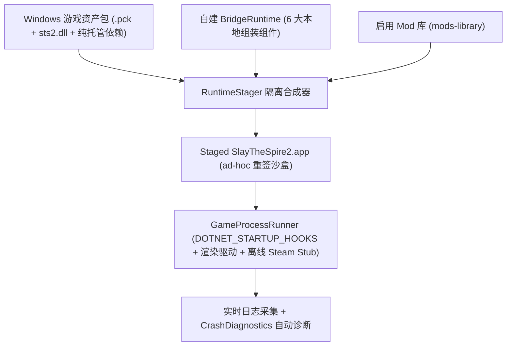

# 架构设计：STS2 Mac Launcher（纯自建 BridgeRuntime 架构）

## 1. 为什么转向纯自建 BridgeRuntime？

《杀戮尖塔2》基于 **Godot 4.5.1 (.NET 9 / C#) + Spine 4.2 + FMOD 2.03.06** 构建：
- **跨平台资产与托管逻辑**：Windows 版 `SlayTheSpire2.pck`（场景、贴图、Spine 骨骼、Shader、本地化文本）与 `sts2.dll`（.NET 9 IL 字节码）完全跨平台；
- **平台绑定层**：差异集中在 Apple Silicon 原生 Godot 宿主、CoreCLR/BCL、Spine/FMOD GDExtension 原生框架，以及 Sentry / Steamworks / Vortice DXGI 等 Windows 专属原生调用。

为了彻底消除对官方 macOS 版 `SlayTheSpire2.app` 的依赖，启动器采用**纯自建 BridgeRuntime 架构**：仅凭合法拥有的 Windows 游戏资产即可在本地组装一套完整的 macOS `arm64` 宿主与兼容层，并在每次启动前合成隔离沙盒。

---

## 2. 自建 BridgeRuntime 目录布局与 6 大组件

默认位于 `~/Library/Application Support/STS2MacLauncher/bridge-runtime/`（支持在 UI 与配置中指定自定义根目录），由 `scripts/setup-bridge-runtime.sh` 幂等生成并输出 `bridge-runtime-manifest.json`：

| # | 组件 | 相对路径 | 上游来源 | 架构 | 许可证 |
| --- | --- | --- | --- | --- | --- |
| 1 | **Godot 4.5.1 Mono** | `godot-template/macos_template.app` (`godot_macos_release.universal`) + `GodotSharp.dll` | `godotengine/godot` (`4.5.1-stable` 导出模板 + NuGet `GodotSharp 4.5.1`) | `arm64` / Universal | MIT License |
| 2 | **.NET 9 osx-arm64** | `dotnet-osx-arm64/`（含 `libhostfxr.dylib`、`libcoreclr.dylib`、`libclrjit.dylib`、BCL DLL、`GodotSharp.dll`、`System.IO.Hashing.dll`） | Homebrew `dotnet@9` self-contained `osx-arm64` 发布提取 | `arm64` | MIT License |
| 3 | **Spine 4.2** | `gdextensions/spine/libspine_godot.macos.template_release.framework` | Esoteric Software `spine-godot` `4.2-4.5.1-stable` | `arm64` | Spine Runtimes License |
| 4 | **FMOD 2.03.06** | `gdextensions/fmod/`（完整模式含 `libGodotFmod.macos.template_release.framework`、`libfmod.dylib`、`libfmodstudio.dylib`；缺失时降级 `stubs/libGodotFmod.stub.dylib`） | `utopia-rise/fmod-gdextension` `6.1.0-4.5.0` + FMOD Engine / 自研静音 stub | `arm64` | GDExtension：MIT；FMOD Engine：Firelight 商业许可；静音 stub：仓库自研源码 |
| 5 | **Native Stubs & Hostfxr Bridge** | `stubs/`（`libsentry.macos.release.dylib`、`libSentry.dylib`、`libsteam_api.dylib`、`libGodotFmod.stub.dylib`、`libhostfxr_bridge.dylib`） | `bridge/native-stubs/*.c` 本地 `clang -arch arm64 -shared` 编译 | `arm64` | 本项目自研源码 |
| 6 | **STS2MacBridge** | `bridge/STS2MacBridge.dll` | `bridge/STS2MacBridge/`（`net9.0` 类库） | AnyCPU IL | 本项目自研源码（引用游戏自带 `0Harmony.dll`，MIT License） |

`BridgeRuntimeInspector` 优先解析 `bridge-runtime-manifest.json`（缺失时回退按约定子目录扫描），使用 Mach-O/fat 解析核验所有原生二进制包含 `arm64` 切片，并输出 `[BridgeComponentState]` 与 `isLaunchReady`。

---

## 3. 核心技术链路与关键边界

### 3.1 `RuntimeStager` 沙盒组装管线
每次启动前，`RuntimeStager` 在 `~/Library/Application Support/STS2MacLauncher/staged/` 临时目录内合成全新的 `SlayTheSpire2.app`，绝不修改原始 Windows 目录与 `bridge-runtime/`：
1. **宿主模板重构**：APFS 克隆 `macos_template.app`，将 `godot_macos_release.universal` 重命名为 `SlayTheSpire2`（清理 debug 二进制），并生成标准 `Info.plist`（`CFBundleExecutable = SlayTheSpire2`、`CFBundleIdentifier = io.github.lengsukq.sts2-mac-bridge`、`NSHighResolutionCapable = true`）。
2. **游戏资产克隆**：APFS 克隆 Windows 主 `.pck` 至 `Contents/Resources/SlayTheSpire2.pck`。
3. **.NET 运行时组装、过滤与 PE 头修补**：
   - 先拷贝纯净的 `dotnet-osx-arm64/`（含 `GodotSharp.dll` 与 `System.IO.Hashing.dll`）至 `Contents/Resources/data_sts2_macos_arm64/`；
   - `ManagedAssemblyFilter` 仅覆写 `sts2.dll`（及 `.pdb`）与纯托管依赖（`0Harmony.dll`、`MonoMod.*`、`SmartFormat*`、`JetBrains.Annotations.dll`、`Steamworks.NET.dll`、`Sentry*.dll`、`Vortice.*.dll`、`SharpGen.*.dll` 等），**严禁覆盖**任何 `System.*`、`Microsoft.*`、`GodotSharp*`、`coreclr`、`hostfxr`、`clrjit` 或 Windows 原生库；
   - **Hostfxr 启动钩子垫片**：由于 Godot 嵌入式 CoreCLR 通过 `hostfxr_initialize_for_runtime_config` + `hostfxr_get_runtime_delegate` 直接调用托管入口而不触发标准的 `DOTNET_STARTUP_HOOKS`，`RuntimeStager` 将 `data_sts2_macos_arm64/libhostfxr.dylib` 保留为 `libhostfxr_real.dylib`，并将自研 `libhostfxr_bridge.dylib` 部署为 `libhostfxr.dylib`；
   - **PE 机器码自动修补 (`PEAssemblyArchPatcher`)**：Windows 版 `sts2.dll` 与 `Steamworks.NET.dll` 虽为 `ILONLY` 纯 IL 程序集，但 PE COFF `Machine` 字段为 `0x8664 (AMD64)`，在 macOS `arm64` CoreCLR 上会触发 `FileLoadException`。`RuntimeStager` 复制后会自动将所有满足 `PE32+ && ILONLY && Machine == 0x8664` 的托管 DLL 原子修补为 `0xAA64 (ARM64)`；
   - **跨平台元数据净化**：生成适配 `osx-arm64` 的 `sts2.runtimeconfig.json`，并从 Windows `sts2.deps.json` 中清洗剔除 `win-x64` 原生节点写出兼容版 `sts2.deps.json`；若 Windows 包根目录存在 `release_info.json`，同步复制到 `Contents/Resources/` 与 `Contents/MacOS/`。
4. **GDExtension 与 Native Stubs 部署**：
   - 依据真实 `.pck` 中 `.gdextension` 声明的精确 `res://` 路径与 `Contents/Frameworks/` 同步部署：
     * FMOD：`res://addons/fmod/libs/macos/libGodotFmod.macos.template_release.framework`、`libfmod.dylib`、`libfmodstudio.dylib`（`stub` 模式下回退部署 `libGodotFmod.stub.dylib`）；
     * Sentry：`res://addons/sentry/bin/macos/libsentry.macos.release.dylib` 与 `libSentry.dylib`；
     * Spine：`res://addons/spine/macos/libspine_godot.macos.template_release.framework`；
     * Steamworks：若用户在设置或 `bridge-runtime/steam/` 提供本机合法 macOS `libsteam_api.dylib`，同步映射 `libsteam_api.dylib` 与 `libsteam_api64.dylib` 以连接本地正版 Steam 客户端。
5. **去隔离与全包重签**：按需写入 `steam_appid.txt`（`2868840`）、同步启用 Mod（仅在 `Contents/Resources/sts2_launcher_staging.json` 记录顺序，避免非 manifest JSON 污染游戏 `mods/` 扫描）、写出 `sts2_launcher_staging.json` 清单，清除 `com.apple.quarantine`，逐一签名内嵌动态库/Framework 后对整个 `.app` 执行 `codesign --force --deep --sign -` 以避免 Apple Silicon AMFI `SIGKILL`。

### 3.2 `STS2MacBridge` 早期托管注入 (`libhostfxr_bridge` + `DOTNET_STARTUP_HOOKS`)
`GameProcessRunner` 启动进程时注入 `DOTNET_STARTUP_HOOKS`（指向 staged 内的 `STS2MacBridge.dll`）以及 `STS2_BRIDGE_HUD`、`STS2_BRIDGE_STEAM_DYLIB`、`STS2_BRIDGE_MODS_DIR`：
1. **`libhostfxr_bridge.dylib` 垫片触发**：Godot 调用 `hostfxr_get_runtime_delegate` 获取 CoreCLR 委托时，`hostfxr_bridge` 转发调用至 `libhostfxr_real.dylib` 并读取 `DOTNET_STARTUP_HOOKS`，一次性执行 `StartupHook, STS2MacBridge::InitializeUnmanaged`（`[UnmanagedCallersOnly(EntryPoint = "InitializeUnmanaged")]`），在 Godot 加载 `sts2.dll` 前完成托管钩子初始化。
2. **`StartupHook.Initialize()`**（位于全局命名空间，仅依赖 BCL 以确保在 `sts2.dll` / `0Harmony.dll` 加载前安全 JIT）：
   - 注册 `AssemblyLoadContext.Default.Resolving` 共享 Godot 主上下文中已加载的程序集；
   - 注册 `AssemblyLoadContext.Default.ResolvingUnmanagedDll` 并为 `Steamworks.NET` 绑定 `NativeLibrary.SetDllImportResolver`，将 Windows 绑定名 `steam_api64` / `steam_api` 重映射至用户本机官方 macOS `libsteam_api.dylib`；
   - 监听 `AppDomain.CurrentDomain.AssemblyLoad`，在 `sts2` 程序集加载时立即应用 Harmony 补丁（同时保留 `[ModInitializer("ModLoaded")]` 兜底入口）。
3. **`PlatformPatches`**（基于 `0Harmony` 宽容反射）：
   - 跳过 `SentryService.Initialize` 并将 `PrefsSave.UploadData` getter 返回 `false`；
   - 拦截 `OsDebugInfo.LogSystemInfo` 与 `OsDebugInfo.GetSystemInfoString`，防止在 macOS 上调用 Windows Vortice/DXGI 导致崩溃；
   - 当 `STS2_BRIDGE_MODS_DIR` 存在时，在 `ModManager.Initialize` 后追加扫描受管 Mod 目录并去重加载；
   - 不绕过正版 Steam 平台初始化与所有权验证。
4. **渲染驱动切换**：通过 `RenderingDriver`（自动 / Metal / Vulkan / OpenGL3）在非自动模式下向 Godot 传递 `--rendering-driver <value>`。

---

## 4. Mod 管理、存档安全隔离与崩溃诊断

- **Mod 管理 (`ModRepository`)**：扫描 `mods-library/` 下的 `mod_manifest.json` / `*.dll` / `*.pck`，启动前执行缺失依赖、未启用前置依赖、循环依赖与缺失入口检查；同步 Mod 时仅清理带 `.sts2_launcher_managed` 标记的受管目录，保护用户手动文件。
- **存档隔离 (`SaveManager`)**：自动发现 `~/Library/Application Support/SlayTheSpire2/` 下 `steam/<AccountID>` 与 `default/<AccountID>` 的普通存档与 `modded/` 存档；支持在 `~/Library/Application Support/STS2MacLauncher/snapshots/` 创建不可变时间戳快照，任何互转或恢复覆盖前均强制先备份目标槽位。
- **崩溃自动诊断 (`CrashDiagnostics`)**：结合退出码与流式 stdout/stderr 日志识别签名失效 / `SIGKILL`、`DOTNET_STARTUP_HOOKS` 注入失败、`deps.json` / `hostpolicy` 解析错误、`Vortice` / `DXGI` 泄漏、`libspine_godot` / `libGodotFmod` 缺失、`libsteam_api` 初始化失败、程序集架构不兼容与 Mod 冲突并给出可操作恢复建议。
- **游戏内悬浮窗 (`InGameOverlayManager`)**：由 `OverlayBootstrap` 在 `NGame._Ready` Postfix 延迟挂载至 `SceneTree.Root` 顶层 `CanvasLayer (Layer=128, ProcessMode=Always)`，纯 `GodotSharp` 组合节点（零自定义 Godot 节点派生、零源生成器依赖），共享 Godot 主 `AssemblyLoadContext` 中已初始化的 `GodotSharp.dll`。每帧通过 `Stopwatch` 无 GC 采样帧时间、1% Low FPS、漏帧与重卡（`>=100ms`），每 `0.5s` 采样进程 CPU 与内存，每 `0.25s` 刷新 UI，支持自由拖动持久化位置、`F9`/`Shift+F9` 显隐与展开、重置统计、全屏切换以及两段防误触快速结束游戏/强退。
